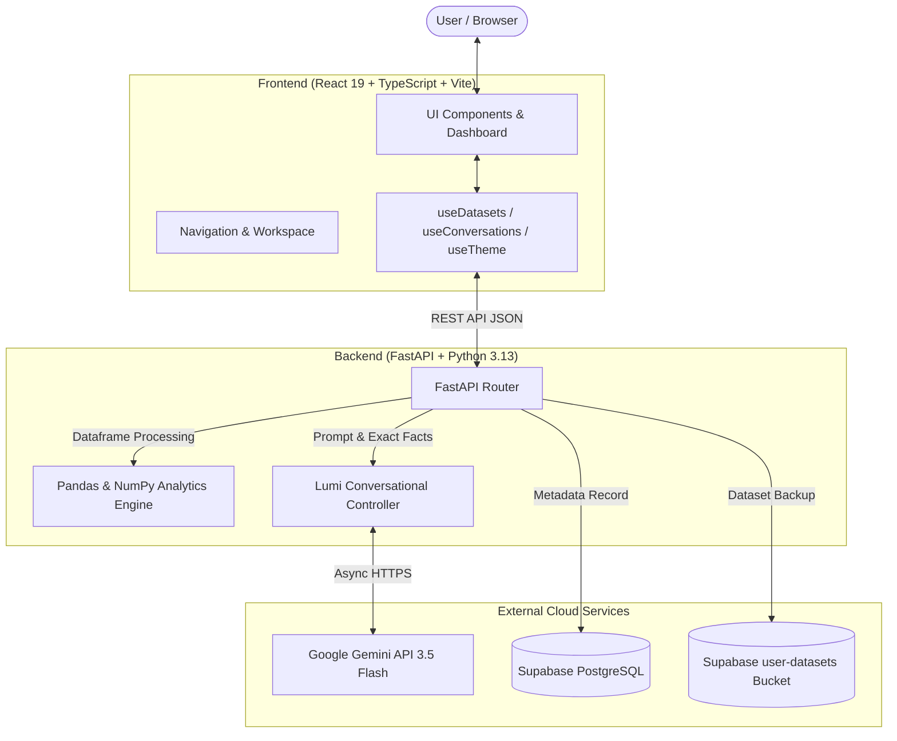

# DataLume AI Analytics 📊⚡

> **Enterprise-Grade AI-Powered Analytics Workspace & Conversational Business Intelligence Platform**  
> Transform raw tabular datasets into interactive visualizations, predictive insights, and natural language intelligence powered by **Google Gemini LLM**, **FastAPI**, and **Supabase Cloud**.

---

<!-- Badges Header -->
<p align="center">
  
  
  
  
  
  
  
  
</p>

---

## 📌 Executive Summary

**DataLume AI** is a production-grade, AI-first data analytics platform designed to bridge the gap between complex data analysis and non-technical business decision-makers. Traditional business intelligence tools like Tableau and Power BI require specialized query knowledge and extensive dashboard configuration. DataLume AI simplifies this by offering:

1. **Instant Automated Profiling** upon file drop (CSV, XLSX, XLS up to 500,000 rows).
2. **Context-Aware Conversational AI ("Lumi")** that can answer queries in English, Hindi, or Hinglish with zero hallucination.
3. **Multi-Chart Interactive Visualizations** featuring 12 chart varieties with live aggregations.
4. **Hybrid Cloud + In-Memory Architecture** delivering sub-second query latency through pandas while persisting files and metadata in Supabase.

---

## 🌟 Comprehensive Feature Breakdown

### 🚀 1. Automated 3-Stage Data Pipeline
The user onboarding begins with a streamlined horizontal pipeline workflow:
* **Stage 01 — Upload Your Data**:
  - Drag-and-drop file upload with support for `.csv`, `.xlsx`, and `.xls`.
  - Client and server-side magic byte and MIME validation to reject invalid or corrupted payloads.
  - Automatic duplicate column renaming (e.g., `Revenue`, `Revenue.1`) to prevent data frame crashes.
* **Stage 02 — Automatic Profiling**:
  - Instant structural inspection calculating row counts, column counts, missing value percentages, unique record distributions, and duplicate row detection.
  - Automatic data type inference (Categorical, Numerical, DateTime, Booleans).
  - Pre-computed statistical summaries: Mean, Median, Min, Max, Standard Deviation, and Quartiles (Q1, Q3, IQR).
* **Stage 03 — Ask Lumi AI**:
  - Immediate conversational access without needing to write SQL or configure filters.

---

### 🤖 2. Lumi AI Assistant (Powered by Google Gemini 3.5)
Lumi is not a simple chatbot; it is a **Hybrid Conversational Data Analyst**:
* **Deterministic Grounding (Zero Hallucinations)**:
  - When asked analytical questions (*"What is the average revenue?"*, *"Which category has the highest sales?"*), the backend runs exact pandas mathematical operations.
  - The deterministic mathematical facts are injected into Gemini's prompt context, ensuring that the model **never invents numbers**.
* **Multilingual Natural Language Understanding**:
  - Communicates fluently in **English**, **Hindi**, and **Hinglish** (*"Is dataset mein kitni rows hain?"*, *"Sabse zyada profit kaunse product ka hai?"*).
* **Typo & Grammar Tolerance**:
  - Handles messy real-world questions gracefully (*"wht is the totl reveue"*, *"show mising valu"*).
* **Zero-Dataset Conversational Intelligence**:
  - If no dataset is uploaded, Lumi engages in general conversation, explains data science concepts, guides users through DataLume features, and discusses business analytics.
* **Multi-Turn Context & Conversation History**:
  - Maintains conversation threads per dataset with rename and delete capabilities.

---

### ☁️ 3. Cloud Database & Storage (Supabase Integration)
* **Storage Bucket (`user-datasets`)**:
  - Every uploaded dataset is safely pushed to Supabase Cloud Storage with unique user-partitioned paths (`user_id/dataset_id/filename`).
* **PostgreSQL Database (`datasets` table)**:
  - Stores dataset metadata, row counts, column types, original filenames, and timestamp audits.
* **Hybrid Architecture**:
  - Data is processed locally in RAM (FastAPI Pandas) for instant sub-second response times, and seamlessly backed up to the cloud.

---

### 📈 4. Rich Interactive Visualizations (12 Chart Varieties)
Built with Recharts and customized for an enterprise dark theme:
1. **Bar Chart**: Category comparisons.
2. **Horizontal Bar Chart**: Ranked metrics and long label names.
3. **Line Chart**: Time-series trends and continuous measurements.
4. **Area Chart**: Volume and cumulative flow over time.
5. **Pie Chart**: Proportional distribution.
6. **Donut Chart**: Composition breakdown with central KPI display.
7. **Histogram**: Frequency distributions and binned intervals.
8. **Scatter Plot**: Correlation and multi-variable distribution.
9. **Correlation Heatmap**: Pearson correlation matrix between all numeric dimensions.
10. **Box Plot**: Outlier detection, medians, and IQR spreads.
11. **Radar Chart**: Multi-variable performance across categories.
12. **Treemap**: Hierarchical categorical sizing.

* **Live Aggregations**: Sum, Average, Count, Minimum, Maximum, Median.
* **Dynamic Slicing**: Top-N filtering (Top 5, 10, 20), column sorting, and custom dimension mappings.

---

### 📋 5. Data Explorer & Table Management
* Fast paginated table viewer supporting search filtering across all columns.
* Data export functionality to filtered CSV.
* Sidebar recent datasets list with one-click dataset switching and individual deletion confirmation.

---

### 🎨 6. Premium UI/UX Design System
* **Monochromatic Charcoal Palette**: `#0a0a0c` workspace with `#141418` glass surfaces.
* **Electric Neon Orange Accents**: `#f97316` and `#ea580c` highlight tokens.
* **Glassmorphism**: Subtle 1px borders (`rgba(255, 255, 255, 0.08)`), backdrop filters, and responsive layout across desktop and mobile.

---

## 🏛️ System Architecture



---

## 📂 Repository Structure

```
datalume-ai/
├── backend/                       # Python FastAPI Backend
│   ├── app/
│   │   ├── __init__.py
│   │   ├── ai.py                 # Gemini LLM logic, grounding & prompt engineering
│   │   ├── analytics.py          # Deterministic pandas statistics, KPIs & charts
│   │   └── main.py               # REST API endpoints, CORS, upload & Supabase
│   ├── requirements.txt          # Python dependencies
│   ├── .env.example              # Backend environment template
│   └── tests/                    # Backend API test suite
├── src/                           # React + TypeScript Frontend
│   ├── components/               # Reusable UI components
│   │   ├── charts/               # Recharts wrappers (Bar, Line, Radar, Heatmap, Boxplot)
│   │   ├── ui/                   # Button, Modal, Drawer, Tooltip, GlassCard
│   │   ├── ChatPanel.tsx         # Lumi AI chat interface
│   │   ├── DataTable.tsx         # Paginated data explorer table
│   │   ├── Sidebar.tsx           # Sidebar with navigation and recent dataset deletion
│   │   └── WelcomeView.tsx       # 3-Stage Data Pipeline empty state
│   ├── css/                      # Modular CSS token system
│   │   ├── base.css              # Reset & typography
│   │   ├── charts.css            # Chart sizing & SVG theme overrides
│   │   ├── glass.css             # Glassmorphism utilities
│   │   ├── layout.css            # App shell, grid & sidebar styling
│   │   ├── pages.css             # Page-specific containers
│   │   └── tokens.css            # CSS variables (colors, borders, spacing)
│   ├── hooks/                    # Custom React hooks
│   │   ├── useConversations.ts   # Chat state & Gemini message streaming
│   │   ├── useDatasets.ts        # Dataset upload, switching & deletion
│   │   └── useTheme.ts           # Theme provider
│   ├── pages/                    # Core view containers
│   │   ├── OverviewPage.tsx      # Main dashboard & KPI strip
│   │   ├── DataExplorerPage.tsx  # Grid data viewing
│   │   └── VisualizationsPage.tsx# Custom chart builder
│   ├── App.tsx                   # Main application router & shell
│   └── main.tsx                  # Vite React DOM entry point
├── run-backend.bat                # Windows 1-click backend launcher
├── run-frontend.bat               # Windows 1-click frontend launcher
├── package.json                   # Frontend npm dependencies & scripts
├── tsconfig.json                  # TypeScript compiler settings
├── vite.config.ts                 # Vite bundler configuration
└── README.md                      # Project documentation
```

---

## 🛠️ Step-by-Step Installation & Setup

### Prerequisites
Make sure you have installed:
- **Node.js** (v18.0.0 or higher) — [Download](https://nodejs.org/)
- **Python** (v3.10 to v3.13) — [Download](https://python.org/)
- **Git** — [Download](https://git-scm.com/)
- A free **Google Gemini API Key** — [Google AI Studio](https://aistudio.google.com/)
- A free **Supabase Project** (Optional for cloud storage) — [Supabase](https://supabase.com/)

---

### 1. Clone the Repository
```bash
git clone https://github.com/adityayadav211207/datalume-ai.git
cd datalume-ai
```

---

### 2. Environment Configuration

#### A. Frontend Configuration (`.env`)
Create a `.env` file in the project root:
```bash
cp .env.example .env
```
Contents of `.env`:
```env
VITE_API_BASE_URL=
VITE_SUPABASE_URL=https://your-project.supabase.co
VITE_SUPABASE_PUBLISHABLE_KEY=your_supabase_anon_key
```

#### B. Backend Configuration (`backend/.env`)
Create a `.env` file inside the `backend/` directory:
```bash
cp backend/.env.example backend/.env
```
Contents of `backend/.env`:
```env
FRONTEND_ORIGIN=http://localhost:5173,http://localhost:5174
MAX_UPLOAD_MB=25

# Google Gemini API
GEMINI_API_KEY=your_gemini_api_key_here
GEMINI_MODEL=gemini-3.5-flash-lite

# Supabase Cloud Database & Storage
SUPABASE_URL=https://your-project.supabase.co
SUPABASE_PUBLISHABLE_KEY=your_supabase_anon_key
SUPABASE_SERVICE_ROLE_KEY=your_supabase_service_role_key
```

---

### 3. Quick Run via Windows Batch Files ⚡

Double-click the provided scripts or run them in PowerShell:

```powershell
# In Terminal 1 (Starts FastAPI Backend on http://127.0.0.1:8000)
.\run-backend.bat

# In Terminal 2 (Starts React Vite Frontend on http://localhost:5173)
.\run-frontend.bat
```

---

### 4. Manual Setup (Terminal / Linux / macOS)

#### Backend Setup:
```bash
# 1. Create Python virtual environment
python -m venv .venv

# 2. Activate virtual environment
# Windows:
.\.venv\Scripts\activate
# Linux/macOS:
source .venv/bin/activate

# 3. Install required Python packages
pip install -r backend/requirements.txt

# 4. Run the Uvicorn server
uvicorn app.main:app --app-dir backend --reload --host 127.0.0.1 --port 8000
```
- **Backend API URL**: `http://127.0.0.1:8000`
- **Interactive Swagger Docs**: `http://127.0.0.1:8000/docs`

#### Frontend Setup:
```bash
# In a separate terminal tab:
npm install
npm run dev
```
- **Frontend App URL**: `http://localhost:5173`

---

## 🗄️ Supabase Cloud Setup (Optional)

To enable cloud backup for uploaded datasets:
1. Create a free project on [Supabase](https://supabase.com/).
2. Open the **SQL Editor** in the Supabase Dashboard and run:
   ```sql
   CREATE TABLE IF NOT EXISTS public.datasets (
       id UUID PRIMARY KEY DEFAULT gen_random_uuid(),
       user_id TEXT NOT NULL,
       name TEXT NOT NULL,
       original_filename TEXT NOT NULL,
       file_type TEXT NOT NULL,
       storage_path TEXT NOT NULL,
       created_at TIMESTAMP WITH TIME ZONE DEFAULT NOW()
   );

   GRANT ALL ON public.datasets TO anon, authenticated, service_role;
   ```
3. In **Storage**, create a new private bucket named **`user-datasets`**.
4. Copy your **Project URL**, **Anon Key**, and **Service Role Key** into `backend/.env`.

---

## 🧪 Testing & Code Quality

DataLume AI includes automated testing and strict typechecking:

```bash
# Run TypeScript compilation check
npm run typecheck

# Run Vitest unit tests (10 test suites, 60+ test cases)
npm test

# Production build bundle check
npm run build
```

---

## 🛡️ Security & Privacy Architecture

* **Zero Frontend Exposure**: LLM API keys (`GEMINI_API_KEY`) and database master credentials (`SUPABASE_SERVICE_ROLE_KEY`) are stored purely on the backend. The frontend client never has access to secret tokens.
* **Strict MIME & File Signature Filtering**: Files undergo binary magic-byte inspection on upload to prevent extension spoofing and executable uploads.
* **Sandboxed Queries**: Calculations are performed natively in memory without executing arbitrary eval strings or unvalidated SQL scripts.
* **Git Safe**: Default `.gitignore` rules ensure that local `.env` and `.venv` folders are never committed to version control.

---

## 👥 Contributors & Contact

- **Aditya Yadav** — Lead Architect & Developer  
  GitHub: [@adityayadav211207](https://github.com/adityayadav211207)  
  Project: [DataLume AI](https://github.com/adityayadav211207/datalume-ai)

---

## 📄 License
This project is licensed under the **MIT License** — feel free to use, modify, and distribute for personal, educational, or commercial projects.
