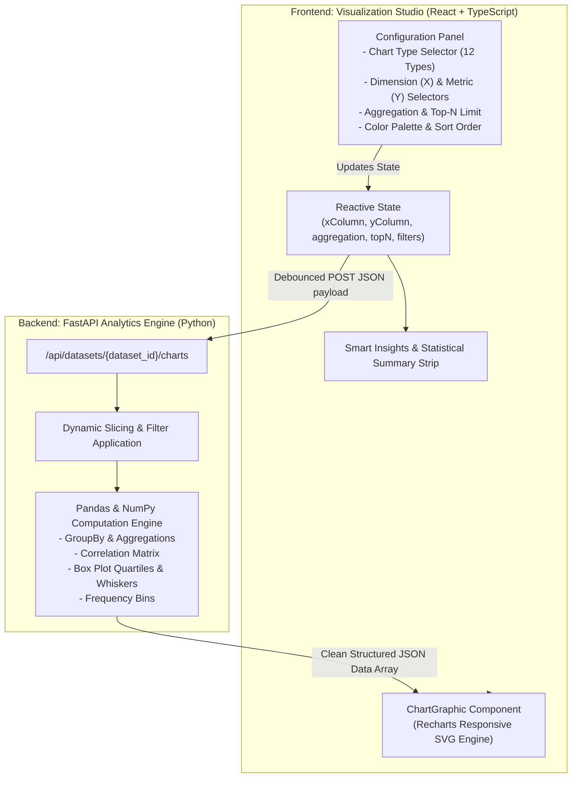

# DataLume AI — Visualization Studio Architecture & Comprehensive Guide 📈🎨

> **Document Type:** Feature Architecture, Developer Reference & Viva / Demo Guide  
> **Platform:** DataLume AI Analytics  
> **Target Module:** `src/pages/VisualizationPage.tsx` & Backend Analytics Engine

---

## 📌 1. What is Visualization Studio?

**Visualization Studio** is DataLume AI's dedicated interactive chart builder and visual discovery engine. It empowers both non-technical business users and data scientists to:
1. Explore high-dimensional tabular data without writing SQL or code.
2. Dynamically map any categorical or numerical column to **12 specialized chart archetypes**.
3. Apply real-time mathematical aggregations (Sum, Mean, Count, Median, Min, Max).
4. Perform multi-dimensional analysis (Correlation Heatmaps, Box Plot outlier detection, Frequency Histograms, and Scatter trends).
5. Switch color palettes, toggle curve smoothness, inspect statistical summary strips, and export report-ready visual artifacts.

---

## 🏗️ 2. Architectural Data Flow

---

## 📊 3. The 12 Supported Chart Archetypes

| # | Chart Type | Best Used For | X-Axis Requirement | Y-Axis Requirement | Backend Calculation |
|---|---|---|---|---|---|
| **1** | **Bar Chart** | Categorical comparisons (e.g. Sales by Region) | Categorical / Text | Numeric (Optional if Count) | `groupby(x)[y].agg()` |
| **2** | **Horizontal Bar** | Long label names, high-count category rankings | Categorical / Text | Numeric | Horizontal coordinate mapping |
| **3** | **Line Chart** | Continuous trends, time-series progression | Date / Numeric / Ordinal | Numeric | Sorted temporal interpolation |
| **4** | **Area Chart** | Cumulative volume, stacked trends over time | Date / Ordinal | Numeric | Gradient fill with monotone curve |
| **5** | **Pie Chart** | Proportions of a whole (under 7 categories) | Categorical | Numeric / Count | Percentage share computation |
| **6** | **Donut Chart** | Executive summary breakdown with central KPI | Categorical | Numeric / Count | Ring layout with inner radius |
| **7** | **Histogram** | Data distribution & normality check | Numeric | Automated frequency count | `pd.cut(bins)` interval binning |
| **8** | **Scatter Plot** | Relationship & correlation between two metrics | Numeric | Numeric | Raw Cartesian paired points `(x, y)` |
| **9** | **Correlation Heatmap** | Matrix of Pearson correlations between all numeric features | Matrix (Auto) | Matrix (Auto) | `df.select_dtypes('number').corr()` |
| **10** | **Box Plot** | Outlier detection, spread, median & IQR | Numeric | Optional group column | Q1, Median, Q3, Whiskers & Outliers |
| **11** | **Radar Chart** | Multi-attribute evaluation across categories | Categorical (Attributes) | Numeric | Polar coordinate projection |
| **12** | **Treemap** | Hierarchical volume visualization | Categorical | Numeric | Nested area proportions |

---

## ⚙️ 4. Real-Time Aggregations Supported

When plotting a metric against a categorical dimension, Visualization Studio provides 6 mathematical aggregation methods:
1. **Count**: Total number of occurrences per category (`count()`).
2. **Sum**: Cumulative total (e.g., Total Revenue, Total Volume) (`sum()`).
3. **Average (Mean)**: Central tendency (`mean()`).
4. **Median**: Midpoint value resilient to extreme outliers (`median()`).
5. **Minimum**: Lowest recorded observation (`min()`).
6. **Maximum**: Peak recorded value (`max()`).

---

## 🎨 5. Design & Customization Controls

Located in the left control sidebar of Visualization Studio:
- **Color Palettes**:
  - `Sunset` (Vibrant warm tones)
  - `Ocean` (Cool cyan & blue tones)
  - `Emerald` (Clean mint and deep greens)
  - `Neon` (High-contrast tech accents)
  - `Monochrome` (Clean grayscale gradients)
- **Top-N Slicing**: Limit output to Top 5, 10, 15, 20, or 50 items to keep charts clean and readable.
- **Sorting Options**:
  - `Descending` (Highest to lowest)
  - `Ascending` (Lowest to highest)
  - `Alphabetical` (A-Z label order)
- **View Modes**:
  - **Dual Mode**: Split-screen with chart on one side and statistical summary table on the other.
  - **Focus Mode**: Full-width maximized canvas for presentations.

---

## 🧠 6. Smart Analytical Insights Strip

Below the chart canvas, Visualization Studio calculates dynamic analytical findings based on the current view:
* **Dominant Category**: Identifies which category holds the highest contribution percentage.
* **Pareto Principle Check**: Analyzes whether top categories account for 80% of total volume.
* **Spread & Disparity**: Computes ratio between highest and lowest recorded groups.
* **Missing Value Flag**: Alerts if any selected dimension has null entries.

---

## 💡 7. Presentation & Viva Talking Points

When demonstrating Visualization Studio in an interview, project viva, or commercial presentation:

1. **"Why not just show static charts?"**
   > *"Static charts are rigid. Visualization Studio gives the user complete autonomy to slice and dice raw data on the fly, switching from a macro-level bar chart to granular correlation matrices in a single click."*

2. **"How does it handle large datasets?"**
   > *"Calculations do not run in the browser's JavaScript thread. The frontend transmits a lightweight config payload to FastAPI, where Pandas runs vectorized aggregation in C-speed RAM, returning only the rendered aggregate coordinates."*

3. **"How does it prevent bad charts?"**
   > *"The UI includes smart input validation: if a user selects a Box Plot or Histogram, non-numeric columns are automatically filtered out of the selection dropdown to prevent invalid configurations."*

---

## 📁 8. Key Code References

- **Frontend Studio Component**: [VisualizationPage.tsx](file:///c:/Users/aditya/Downloads/data%20analytics/datalume-ai/src/pages/VisualizationPage.tsx)
- **Chart SVG Engine**: [ChartGraphic.tsx](file:///c:/Users/aditya/Downloads/data%20analytics/datalume-ai/src/components/ChartGraphic.tsx)
- **Backend Chart API Endpoint**: [backend/app/main.py](file:///c:/Users/aditya/Downloads/data%20analytics/datalume-ai/backend/app/main.py#L256-L352)
- **Color Tokens & Palettes**: [src/lib/constants.ts](file:///c:/Users/aditya/Downloads/data%20analytics/datalume-ai/src/lib/constants.ts)
